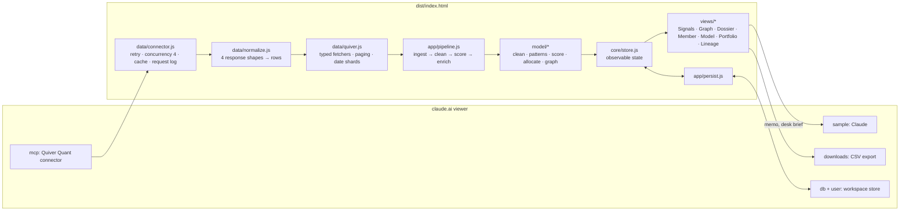

# Architecture

Paper Trail is a single-page app that runs inside claude.ai as an artifact. It has no server of its own: every byte of market data comes through the viewer's **Quiver Quant connector** (`claude.use("mcp")`), Claude features go through `claude.use("sample")`, and the workspace is saved with `claude.use("db")`. The build inlines everything into one HTML file, `dist/index.html`.



## Layers

| Layer | Files | Responsibility |
|---|---|---|
| Core | `src/core/` | Config, date and number formatting, a tiny observable store. No DOM. |
| Data | `src/data/` | Talking to the connector: response normalisation, paging, retries, request log. No DOM. |
| Model | `src/model/` | Pure functions: cleaning, role classification, pattern detection, scoring, allocation, graph building. Fully unit-tested. |
| App | `src/app/` | The pipeline that strings data and model together, and workspace persistence. |
| UI | `src/ui/` | Escaping HTML templates, icons, charts (hand-written SVG), overlays (palette, drawer, modal, toasts, tooltips). |
| Views | `src/views/` | One module per screen. Each exports `{ el, render(state, changedKeys), … }`. |
| AI | `src/ai/` | Prompt builders and the streaming helper for Claude. |

Only `core`, `data` and `model` are imported by the tests, so they stay free of DOM access.

## Connector behaviour we depend on

The Quiver connector returns results in four shapes. `data/normalize.js` handles all of them, and `tests/normalize.test.mjs` pins them:

1. **One text block per row** for normal list results.
2. **A truncated wrapper** once a response passes about 75,000 characters: `{truncated, original_item_count, returned_item_count, items}`. Paging advances by `returned_item_count` and continues while the server reports a full page (`tests/connector.test.mjs`).
3. **An empty-result wrapper**: `{count: 0, results: [], message}`. Treating it as a row would create a phantom ticker.
4. **A single object** for profile tools (ownership, politician).

Page sizes (150 rows for trades, 200 for aggregates) keep most responses under the truncation limit. Form 4 purchases are fetched in 7-day shards in parallel, because a 30-day window holds roughly 1,400 purchases.

## Pipeline

`app/pipeline.js` runs on load, on window change, and on Refresh:

1. **Ingest**, in parallel:
   - Form 4 code-P purchases for the window
   - every congressional trade filed in the window (sales are needed to spot same-day buy/sell pairs)
   - Quiver's per-ticker congressional aggregates for the window
   - the same aggregates for 90 days, used for convergence
2. **Clean**. Drop rows without a valid ticker, mutual-fund share classes, out-of-window or future dates, zero shares or prices, prices under 5 cents (unit mismatches), single lines above $2B (seen in the wild: a $10 trillion row) and duplicates. Classify each buyer as C-suite, officer, director, fund or holder.
3. **Score** with `model/score.js` (see [SIGNAL_MODEL.md](SIGNAL_MODEL.md)).
4. **Enrich**. For the top 15, pull 90 days of all Form 4 activity per ticker and apply an insider-selling adjustment. The table re-ranks live as these land.

Each stage reports status, rows, pages and timing into the store. The status bar and the Lineage view read them from there. A generation counter discards results from a run that a newer run has replaced.

## State and rendering

`core/store.js` holds one state object. `set(patch)` notifies subscribers with the list of top-level keys that changed, and each view re-renders only the parts that depend on those keys. Views are mounted once and hidden or shown. The graph view stops its simulation when hidden.

All markup goes through the `html` tagged template in `ui/html.js`, which escapes every interpolated value. Filing data such as insider names, bill text and headlines is untrusted input.

## Persistence

`app/persist.js` stores the workspace (watchlist, notes, portfolio settings, model weights, last visit) in the artifact's `db` under the viewer's private path `data/users/<id>/workspace`. It falls back to `localStorage` when `db` is unavailable. Writes are debounced and serialised, one at a time. A snapshot listener picks up changes made on another device.

## Capabilities declared at publish

```json
{
  "mcp": { "servers": [{ "server": "Quiver Quant", "tools": ["get_congress_trades", "get_insider_trading", "get_gov_contracts", "get_lobbying", "get_dark_pool", "get_quiver_newsfeed", "get_ticker_ownership", "get_congress_politician"] }] },
  "sample": {},
  "downloads": true,
  "db": {},
  "user": {}
}
```

Each capability can be missing for a given viewer, and the UI degrades per capability. Without `mcp` the page explains how to get live data. Without `sample` the memo and brief buttons are disabled with a reason. Without `db` the workspace is kept in local storage.

## Build and test

```bash
npm ci
npm test          # node:test, no browser needed
npm run build     # writes dist/index.html
npm run check     # fails if dist/ is stale (used in CI)
```

d3 (force layout only) loads from cdnjs at a pinned version. Fonts load from Google Fonts. The rest is inlined.
